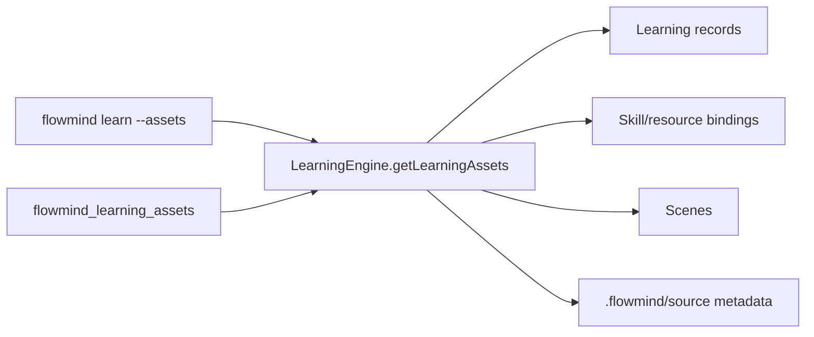

# Design

The learning engine aggregates existing in-memory state and recursively lists source-file metadata. It returns a stable object containing summary, feedback, skills, scenes, resource bindings, and packages. Existing resource-binding sanitization is reused. No database, network, or mutation is involved.

## Test design

- Engine aggregation with a credential-bearing binding.
- Skill/limit filtering.
- CLI JSON contract.
- MCP discovery and execution.
