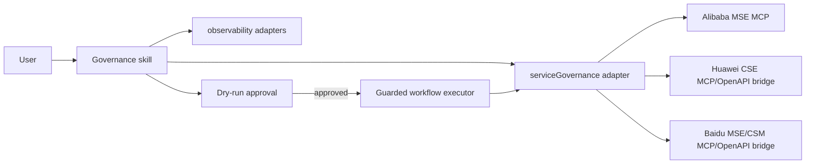

# Design

## Flow

## Component contract

The `serviceGovernance` adapter exposes service, instance, topology, health, policy, preview, create, and update operations. Provider adapters map these local operations to configurable MCP tool names.

## Safety

- Audit and diagnosis are read-only.
- Change execution defaults to preview.
- The workflow executor allowlists `service-governance-change`.
- Delete operations are intentionally excluded from the first release.
- Production changes require an approval token bound to the exact suggested input.

## Configuration

Each provider accepts MCP transport configuration and optional `tools` overrides. Required identifiers such as region, project, engine, namespace, and environment come from resource bindings or the request.

## Data/API impact

No database changes. New public MCP capability group: `governance`.

## Testing

- Adapter mapping and normalization tests.
- Audit and diagnosis result tests.
- Mutation preview/execute boundary tests.
- Resource-binding and capability-catalog discovery tests.
