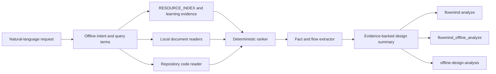

# Design

Routing applies this precedence: explicit skill selection, learned user route, AI selection when available, then deterministic skill rules. `offline-design-analysis` is excluded from automatic rule and AI candidate routing while an AI provider is available, unless the request explicitly asks for offline/no-model analysis. Markdown fallback triggers marked as broad (for example `流程`) cannot override a custom `canHandle` rejection. Learned fuzzy matches require at least 0.72 bigram Dice similarity and the same action family (`analyze`, `execute`, `query`, or `general`).

## Components

- `core/offline-analysis.js` owns bounded discovery, safe parsing, ranking, extraction, and report composition.
- `FlowMind.analyzeOffline()` enriches the analyzer with sanitized learning assets.
- `offline-design-analysis` provides natural-language routing and the standard skill result contract.
- CLI and MCP call the direct core API so explicit offline execution never depends on skill selection or AI availability.

## Retrieval and confidence

The query tokenizer keeps Latin identifiers and creates short Chinese n-grams after removing instruction words. `RESOURCE_INDEX.md` title, aliases, modules, domains, and tags boost matching material paths. Path/title, headings, and bounded body occurrences contribute deterministic scores. Learning feedback and rules are virtual local sources.

Confidence is based on source diversity, matched query coverage, and extracted evidence. It is reported as `high`, `medium`, or `low`; low confidence includes a limitation explaining that human confirmation is needed.

## Safety

- Resolve and validate all discovered paths beneath an allowed root.
- Skip symbolic-link descendants, hidden secret files, vendor/generated directories, binaries, and oversized files.
- Read Lakebook tar entries in memory without extraction; reject unsafe paths and oversized/non-JSON entries.
- Strip HTML tags/scripts and redact credential-like assignments before returning excerpts.
- Never execute analyzed code or perform network access.

## Test design

- Markdown/Lake/code retrieval and ordered flow extraction.
- Safe Lakebook parsing and unsafe archive-entry rejection.
- Learning evidence inclusion and credential redaction.
- Natural-language routing with all AI providers disabled.
- Analysis-flow versus auto-flow collision regression.
- Explicit option and conversational-correction route learning.
- CLI JSON contract and MCP discovery/execution.
