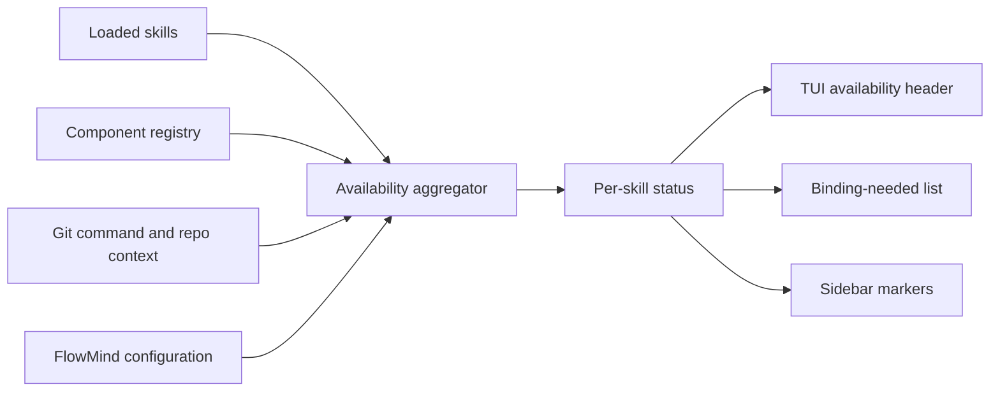

# Design

## Status model

Statuses are evaluated in this order: `disabled`, `needs-binding`, `needs-git`, `ready`. MCP dependencies are ready only when an enabled, initialized adapter exists and an MCP adapter has a transport URL. Git-dependent skills require both the Git executable and a `.git` repository in the current directory or an ancestor.

The check is local and side-effect free. It reports configured usability, not remote service health; no MCP network probe runs during TUI rendering.

## TUI presentation

- The first readiness line summarizes usable skills, attention count, MCP components, Git, and config counts.
- The second line names every skill that needs an MCP component, Git context, or enablement.
- `✓` means usable, `⚠` means action is required, and `○` means disabled. ASCII mode uses `[OK]`, `[!]`, and `[OFF]` equivalents.
